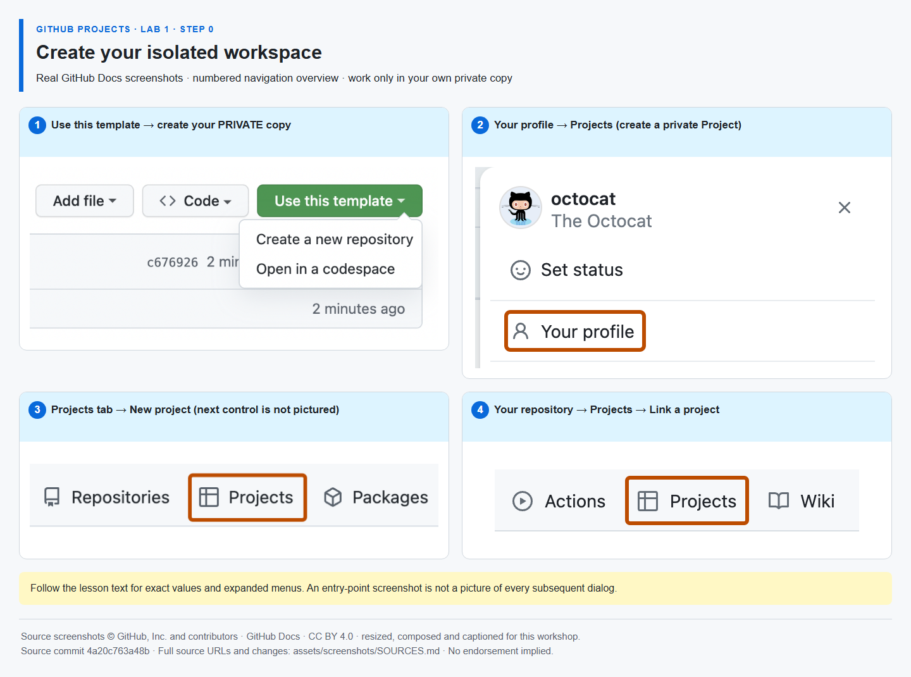

# Step 0 — Create your isolated workspace

**Time: 12 minutes · Topic: your private repository and GitHub Project**

## What and why

Your repository stores instructions, issues and pull requests. Your Project organizes those work items into planning views. Use the GitHub website only. Keep the same private repository and Project for all three labs.

## Do

1. If reading the public guide, choose **Use this template → Create a new repository** on [the Lab 1 starter](https://github.com/alvine-aurelio-org/bsp-github-projects-lab-1/generate). Select **your own account**, name it `my-projects-workshop`, select **Private**, leave **Include all branches** off and create it. If Mona posted this in your private copy, this part is already done: **do not create another repository**.
2. Open **Issues → Mona's GitHub Projects workshop — start here** in your copy. **Mona creates only this one issue.** All instructions and feedback stay in the same thread. If it has not appeared, open **Actions → Mona — guided workshop → Run workflow → main** once. Stay on the GitHub website throughout the lab.
3. For a personally owned repository, choose **profile picture → Your profile → Projects → New project → Table**. If your repository belongs to an approved organization, use **that organization's Projects tab → New project → Table** instead. Name it `My digital-service release`. In the Project's **… → Settings**, confirm **Private** visibility. Return to your repository → **Projects → Link a project** and select it. The repository and Project must show the **same owner**. If you already have this dedicated Project, use it instead of creating another. Keep Mona's issue and the Project in separate browser tabs so you can switch between the instructions and your work.

_The annotated overview uses real GitHub Docs screenshots; numbered captions identify entry points, not unshown dialogs. [Image attribution](https://github.com/alvine-aurelio-org/bsp-github-projects-lab-1/blob/main/assets/screenshots/SOURCES.md)._

## Expected result

- One private repository under your account, open in your browser.
- One private Project under the same account, linked from the repository's Projects tab.
- Exactly one automatically created issue exists: Mona's start-here thread. You will create work items yourself when Step 1 asks; those are your backlog, not additional lesson threads.

## Tell Mona

**Open your GitHub Project. Copy its URL from your browser's address bar. Paste only that URL as a new comment below.**

Do not add a command, replace any placeholders or edit the link. Mona saves the Project link and shows the next step.
