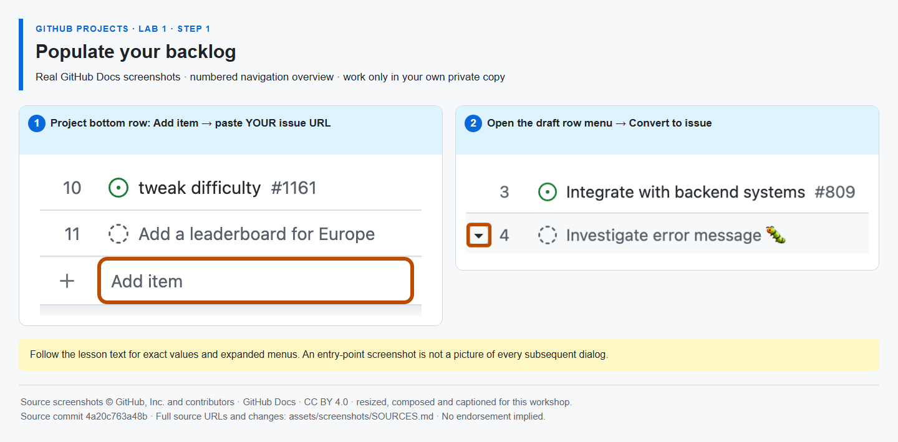

# Step 1 — Populate your backlog

**Time: 10 minutes · Topic: learner-created issues, draft ideas and one source of truth**

## What and why

A Project item references a repository issue; it is not a second copy of the task. You create the work items as this hands-on activity. **Mona never creates them for you.** The one start-here issue remains the only instruction thread. Draft items capture ideas before they have a repository; conversion makes an idea a real issue.

## Do

1. In [your repository's Issues tab](https://github.com/{{REPO}}/issues), select **New issue → Blank issue** (or **New issue** if no chooser appears). Create these **four open work issues**, signed in as **@{{LEARNER}}**. Copy each title exactly and use the short description supplied. Note each actual issue number; do not assume sequential numbers.

   | Role           | Exact title                                           | Description to paste                                                                                                         |
   | -------------- | ----------------------------------------------------- | ---------------------------------------------------------------------------------------------------------------------------- |
   | Feature        | `[Workshop] Deliver the digital-service enhancement`  | Fictional feature: publish a service release checklist and retain unfinished verification for Sprint 2.                      |
   | Implementation | `[Workshop] Publish the service release checklist`    | Update work/release-checklist.md through a PR. Acceptance: check the first checklist item. Do not close this issue manually. |
   | Verification   | `[Workshop] Verify the release checklist in Sprint 2` | Verify after implementation; keep this task open and carry it into Sprint 2.                                                 |
   | Bug            | `[Workshop] Correct the fictional help-link wording`  | A fictional help label is unclear. Keep this small, low-priority item in the backlog.                                        |

2. Open [your Project]({{PROJECT_URL}}). In the bottom **Add item** row, paste the URL of each issue you just created and press Enter. Then type `Prepare the fictional release announcement` in Add item and press Enter to create a draft. Open that draft's row menu **… → Convert to issue** and select **your private repository**. This announcement is the fifth work item; it is not one of the four roles registered below.
3. Rename the Table view **Backlog** and save changes if shown. Do **not** add Mona's start-here issue to the Project. Leave all work issues open. Return to the **same Mona thread** to register the four role numbers.



_The row-menu button is shown; the Convert to issue dialog is described in the text. [Image attribution](https://github.com/alvine-aurelio-org/bsp-github-projects-lab-1/blob/main/assets/screenshots/SOURCES.md)._

## Expected result

Your Backlog contains five work issues **you created**: the four roles plus the converted announcement. Each points only to your repository. Mona still has just one instruction thread. `Feature`, `Task` and `Bug` in titles describe the scenario; they are **not a claim that organization-wide issue types were configured**.

## Register your backlog with Mona

Replace the four placeholders with your actual issue numbers in **feature, implementation, verification, bug** order. Keep the `#` before each number and post this as **one new comment in Mona's existing exercise issue**:

```text
/backlog #FEATURE #IMPLEMENTATION #VERIFICATION #BUG
```

**MIXED EVIDENCE:** Mona verifies the four open issues' native identities, exact role titles and that you created them in this repository after starting the exercise. Project membership and draft conversion are **SELF-CONFIRMED by your command**. No work issue is created or edited by Mona. A failed check gives feedback in the same thread, without unlocking the next step. `/done 1-1` cannot bypass registration.
