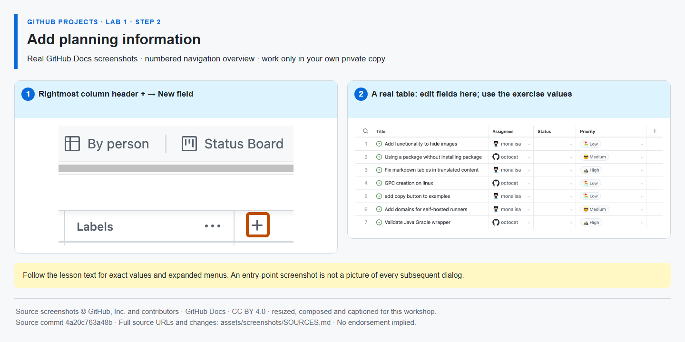

# Step 2 — Add planning information

**Time: 10 minutes · Topic: custom fields, priority, estimation and ownership**

## What and why

Fields store comparable planning information. A single-select field keeps priority values consistent; a number field supports effort totals. Assignees answer who is responsible. These fields are planning conventions, not mandatory-field enforcement or capacity calculations.

## Do

1. In your Project's Backlog table, select the rightmost column-header **+ (Add field)**. Choose **Add issue fields → Create a project field** to open the custom-field form; older layouts may offer **New field** directly. Create **Priority**, type **Single select**, options **High**, **Medium**, **Low**. Repeat for **Effort**, type **Number**. If a correctly typed field already exists, reuse it; confirm Priority has the three requested option names rather than creating duplicate fields.
2. Set the sample values:

   | Item | Priority | Effort |
   |---|---|---:|
   | Implementation #{{ISSUE_implementation}} | High | 3 |
   | Verification #{{ISSUE_verification}} | Medium | 2 |
   | Bug #{{ISSUE_bug}} | Low | 1 |

   Leave Effort blank for the feature and announcement. This avoids counting both parent-level planning and task effort.
3. Show **Assignees** if hidden. Assign the implementation issue to **yourself**; leave verification unassigned for the workload exercise later.



*The example values may differ; use the exact values above in your own Project. [Image attribution](https://github.com/alvine-aurelio-org/bsp-github-projects-lab-1/blob/main/assets/screenshots/SOURCES.md).*

## Expected result

Priority is single-select, Effort is numeric, implementation has Effort 3 and your assignment, verification has Effort 2 and no assignee.

## Tell Mona

```text
/done 1-2
```

Post this in Mona's exercise issue. **SELF-CONFIRMED:** field configuration and values are not API-verified.
