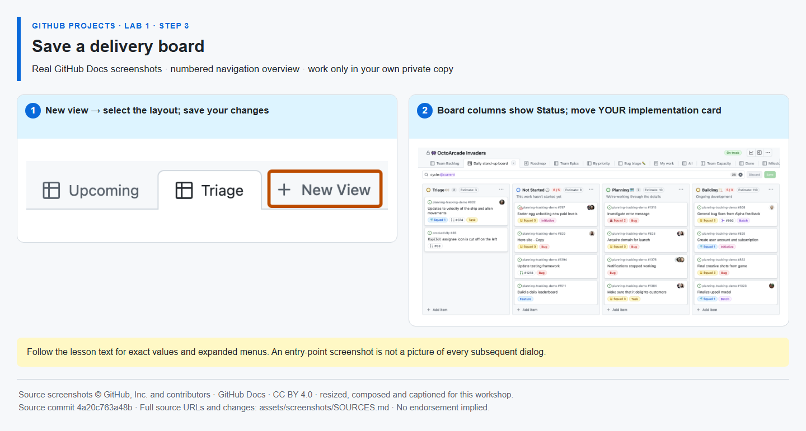

# Step 3 — Save a delivery board

**Time: 8 minutes · Topic: views and Kanban flow**

## What and why

A Board is another view of the **same five issues**. Its Status columns show delivery flow. Dragging a card changes its Status; it does not create another task. Saved views make a repeatable perspective instead of an unsaved personal arrangement.

## Do

1. Click **New view**, select **Board** and name it **Delivery board**. In the **View** settings beside the search bar, set the column field to **Status**. Keep the default **Todo**, **In progress** and **Done** options.
2. Set the implementation and verification tasks to **Todo**, then move only implementation to **In progress**. If other items have no status, give them Todo.
3. Save view changes when prompted. Switch back to **Backlog** and confirm the same implementation issue now shows **In progress**. Return to Delivery board.



*A static screenshot shows where cards and columns appear; it does not capture an actual drag gesture. [Image attribution](https://github.com/alvine-aurelio-org/bsp-github-projects-lab-1/blob/main/assets/screenshots/SOURCES.md).*

## Expected result

Backlog and Delivery board show the same work. Only implementation is in progress. You still own exactly one repository and one Project.

## Tell Mona

```text
/done 1-3
```

**SELF-CONFIRMED.** Mona celebrates Lab 1 and posts Lab 2 in this same issue. Do not copy or clone another laboratory repository.
