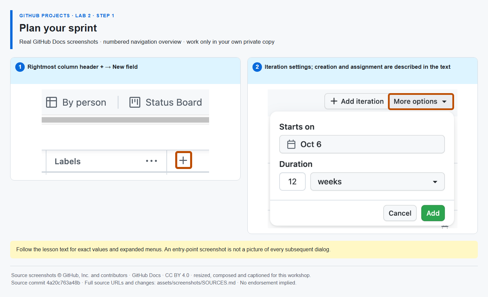

# Step 1 — Plan your sprint

**Time: 8 minutes · Topic: iterations and sprint commitment**

## What and why

An iteration field assigns work to a timebox. It is different from a repository milestone, which groups a release. Planning work in an iteration makes the team's short-term commitment visible without copying issues into a second board.

## Do

1. Open [the same Project]({{PROJECT_URL}}) → Backlog. Select the rightmost **+ (Add field)**, then **Add issue fields → Create a project field** (older layouts may offer **New field** directly). Name **Sprint**, type **Iteration**. Set **Starts on** to today or your agreed sprint start this week, and explicitly choose a **one-week** duration. Do not assume the default starts on Monday or lasts one week.
2. In Project **… → Settings → Sprint**, rename the first two iterations **Sprint 1** and **Sprint 2**. Read their displayed start/end dates: each covers seven days, and Sprint 2 starts the day after Sprint 1 ends. Create the second iteration if necessary. Reuse an existing correctly configured Sprint field; do not copy dates from a screenshot or add a second Sprint field. Return to Backlog.
3. Set only implementation #{{ISSUE_implementation}} and verification #{{ISSUE_verification}} to **Sprint 1**. In the view settings, choose **Group by → Sprint** and **Field sum → Effort**. This menu is multi-select: clear **Count** if selected so you read the effort total rather than the number of items. **Save** the view. Check the Sprint 1 group shows **Effort 5** (3 + 2), not Count 2; effort is not available working hours.



*The iteration-settings screenshot shows the settings area; follow the text for initial field creation and naming. [Image attribution](https://github.com/alvine-aurelio-org/bsp-github-projects-lab-1/blob/main/assets/screenshots/SOURCES.md).*

## Expected result

Two distinct iterations exist. Sprint 1 contains the two delivery tasks with total Effort 5.

## Tell Mona

```text
/done 2-1
```

**SELF-CONFIRMED:** iteration setup and Project totals are not API-verified.
