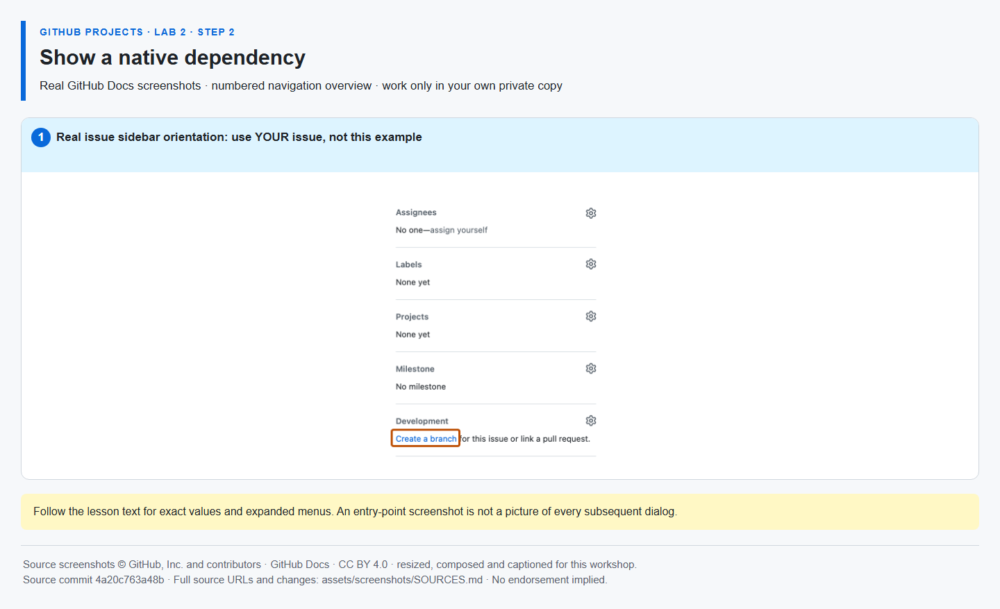

# Step 2 — Show a native dependency

**Time: 7 minutes · Topic: blockers and delivery sequencing**

## What and why

A native issue dependency says which task must precede another. A sentence or checkbox containing an issue number is **not** a native dependency. Dependencies communicate sequencing; they do not prevent someone from changing Status or merging a PR.

## Do

1. Open the **verification issue**: `https://github.com/{{REPO}}/issues/{{ISSUE_verification}}`.
2. In its issue sidebar, find **Relationships**, open its **…** menu and choose **Mark as blocked by**. Search for or paste the URL of implementation #{{ISSUE_implementation}} and select it. The wording may appear as **Add blocked by** in an updated interface.
3. Confirm verification shows **Blocked by → implementation**. Open implementation and inspect the reciprocal **Blocking → verification** relationship. Do not reverse them.



*This overview orients you to a real issue sidebar. The exact Relationships menu is described above because the source screenshot does not display that menu. [Image attribution](https://github.com/alvine-aurelio-org/bsp-github-projects-lab-1/blob/main/assets/screenshots/SOURCES.md).*

## Expected result

Verification is blocked by implementation, both in your own repository.

## Ask Mona to check

```text
/check 2-2
```

**REPOSITORY-VERIFIED:** Mona reads GitHub's native issue-dependency endpoint. A body link, a label, a Project field or `/done 2-2` cannot pass. If access or the API fails, progress is not awarded; retry the check after correcting the issue.
