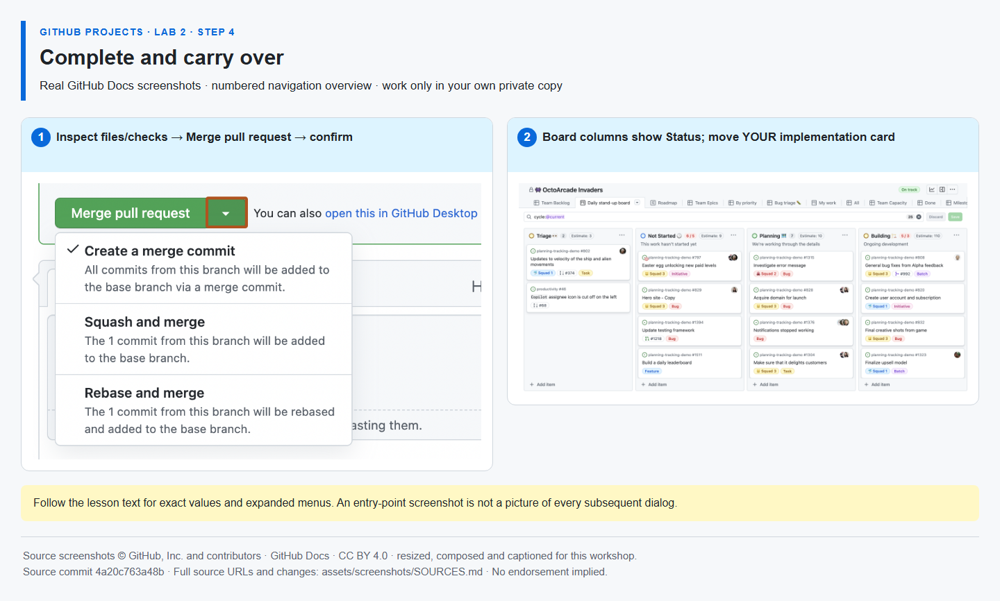

# Step 4 — Complete and carry over

**Time: 8 minutes · Topic: delivery traceability, built-in automation and carry-over**

## What and why

Merging a linked PR into the default branch closes its referenced issue. A Project's built-in workflow can then mark that item Done. Unfinished work moves to the next iteration rather than being hidden. This solo exercise is **self-inspection, not independent review or self-approval**.

## Do

1. Only after Mona's Step 2-3 pass, open your Project **… → Workflows**. Confirm **Item closed → Status: Done** is **On**; enable it only if it is Off. Return to PR #{{PR_NUMBER}}, inspect **Files changed** and wait for **Workshop verification** to pass. Do not modify the PR after Mona's Step 3 check.
2. Select **Merge pull request → Confirm merge** (or the permitted squash option). No approval is required in a personal sandbox. Never disable organizational protections to force the exercise; if a managed account requires an external reviewer, that policy is a prerequisite limitation of that environment.
3. Confirm implementation #{{ISSUE_implementation}} closed as completed and its Project card becomes Done. Keep verification #{{ISSUE_verification}} **open** and change only that task's Sprint to **Sprint 2**. Implementation stays in Sprint 1. Save any view changes.



*The screenshot shows entry points; use your own task and the actual Sprint field for carry-over. [Image attribution](https://github.com/alvine-aurelio-org/bsp-github-projects-lab-1/blob/main/assets/screenshots/SOURCES.md).*

## Expected result

Traceability: implementation issue → work branch → PR → merge → closed issue. Verification remains open in Sprint 2. A closed issue and a Project Status are related but separate values.

## Ask Mona to check

```text
/check 2-4 #{{PR_NUMBER}}
```

**MIXED EVIDENCE:** Mona verifies the same checked PR/head, merge into main, native issue link, implementation closure, open verification and the merged checklist. By submitting the command, you **self-confirm** Project Done and Sprint 2 carry-over; Mona cannot inspect those fields. It then posts Lab 3 in the same issue.

**If blocked:** if GitHub already shows **Merged** but Mona reports missing merge metadata or unavailable repository evidence, preserve that merge. Rerun the failed Mona Actions job once; if the same error returns, stop and report the run URL and exact error. Do not recreate or reopen the PR, edit bot progress or use `/done` to bypass this check. A successful PR quality check is not a Mona completion check.
