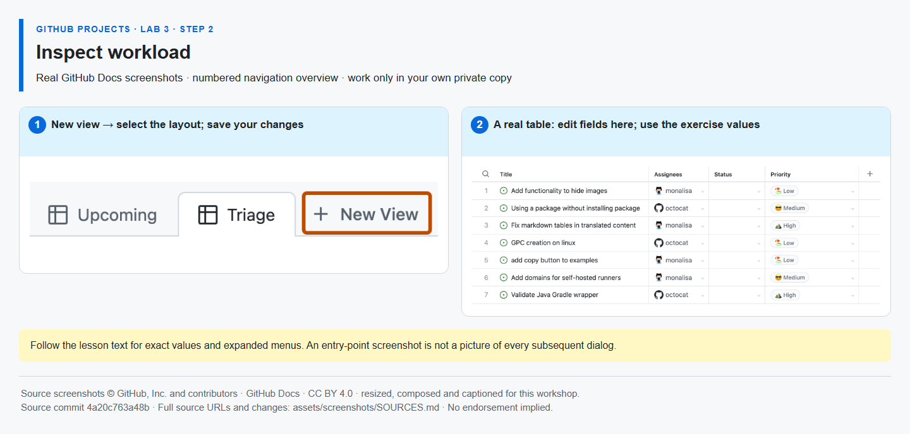

# Step 2 — Inspect workload

**Time: 8 minutes · Topic: grouping, effort totals and ownership gaps**

## What and why

Grouping by Assignees reveals who owns work and which tasks are unassigned. Summing Effort makes relative work size visible. It does **not** calculate available hours, leave, cost rates or a person's actual capacity.

## Do

1. Create a **Table** view named **Workload**. Clear inherited filters, then filter to **open** issues using `is:open`; completed implementation should not appear in this view.
2. Open the **View** settings beside the search bar → **Group by → Assignees**. Show Effort and Sprint. Set **Field sum → Effort** (the wording may be **Sum of**). This menu is multi-select: clear **Count** if selected so the displayed total is effort, not the number of items. Save the view.
3. Find verification #{{ISSUE_verification}} in the unassigned group with Effort **2**. Assign it to yourself and observe it move to your group. No other participant or instructor is needed. Leave its Sprint 2 assignment unchanged.



*This overview shows a table, not an expanded Group by menu; follow the exact text above for the grouping controls. [Image attribution](https://github.com/alvine-aurelio-org/bsp-github-projects-lab-1/blob/main/assets/screenshots/SOURCES.md).*

## Expected result

The saved Workload view shows open work by assignee. The verification task has an owner; it did not disappear from the Project or move to another repository.

## Tell Mona

```text
/done 3-2
```

**SELF-CONFIRMED:** grouping, filter and totals are not API-verified. Keep actual unassigned work visible in a real delivery process rather than removing its rows.
