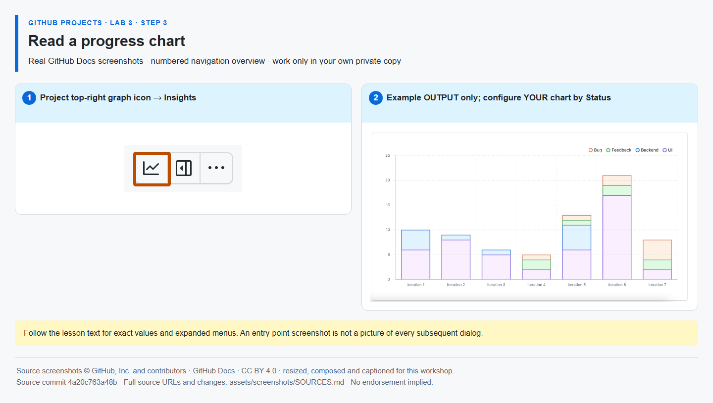

# Step 3 — Read a progress chart

**Time: 7 minutes · Topic: current Insights and interpretation**

## What and why

Insights charts summarize items already in the Project. A current chart shows today's distribution; a historical chart needs real observations over time. One workshop session is not evidence of multi-week velocity or burn-down.

## Do

1. Open your Project and select **Insights**, the graph icon near the top-right. Choose **New chart**, then **Configure**.
2. Name the chart **Delivery status**. Choose a **Column** layout, X-axis **Status**, and Y-axis **Count of items**. Clear unnecessary filters, save changes and inspect the categories. Use count, not Effort, for this activity.
3. Answer for yourself: which status contains the most items, and why is a task count different from remaining effort? Check that a completed implementation contributes to Done rather than assuming every merged PR is a separate planned task.



*The example chart is by iteration, not your required Status configuration. It illustrates the output only; the settings to use are specified above. [Image attribution](https://github.com/alvine-aurelio-org/bsp-github-projects-lab-1/blob/main/assets/screenshots/SOURCES.md).*

## Expected result

A saved current chart named Delivery status visualizes your Project's actual Status values. If Insights is unavailable under an account policy or entitlement, do not claim a chart was created: resolve access or record the lab as incomplete. No paid add-on, AI or cloud service is introduced by this workshop.

## Tell Mona

```text
/done 3-3
```

**SELF-CONFIRMED:** submitting this confirms you created and interpreted the chart. Mona does not grade the image or call a chart API. You may add your interpretation in a separate ordinary comment.
